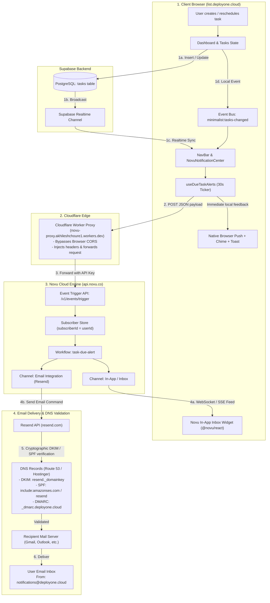

# Notification Architecture & Workflow Pipeline

This document explains how notifications and due-date alerts travel from the client browser through the entire cloud infrastructure to the user's inbox and in-app notification center.

---

## 1. High-Level Architecture Diagram



---

## 2. End-to-End Hop-by-Hop Journey

### Hop 1: Task Scheduling & State Synchronization (Browser + Supabase)
1. **User Action**: A user creates or reschedules a task on `list.deployone.cloud` with a due date (e.g., due in 15 minutes).
2. **Database Mutation**: The task is persisted to Supabase via `useTasks()`.
3. **Cross-Component Broadcast**:
   - `useTasks` dispatches a `minimalist:tasks-changed` CustomEvent to instantly update all open views (`NavBar`, `Dashboard`, `Planning`).
   - Supabase Realtime channel (`user-tasks-${user.id}`) synchronizes any background or multi-tab edits.
4. **Active 30-Second Monitor**:
   - `useDueTaskAlerts` runs a 30-second interval ticker.
   - It re-evaluates all pending tasks against the user's notification threshold (default: 24 hours).
   - If a task is overdue or imminent (<= 1 hour), it evaluates the deduplication cache (`sessionStorage['minimalist_notified_task_ids']`).
   - If the task has not been notified within 30 minutes, or if its `due_date` was modified, the alert triggers immediately.

---

### Hop 2: Instant Client Alerts
Before making network requests, the browser triggers instant feedback:
- **Audio Chime**: `playDueAlertSound()` produces a sine-wave audio alert using the Web Audio API.
- **Browser Push Notification**: `sendBrowserDueNotification()` fires a native OS/browser notification (if granted).
- **In-App Toast**: `toast.warning()` via Sonner alerts the user directly on screen.

---

### Hop 3: Cloudflare Worker Proxy (Bypassing CORS)
1. **The Problem**: Web browsers enforce the Same-Origin Policy (CORS). Direct client-side calls to `https://api.novu.co/v1/events/trigger` would be blocked by CORS unless proxied.
2. **The Proxy Solution**:
   - In production, client requests are routed to:
     ```
     https://novu-proxy.akhileshchoure1.workers.dev
     ```
   - Configured via environment variable: `VITE_NOVU_PROXY_URL`.
   - The Cloudflare Worker intercepts the request, responds with `Access-Control-Allow-Origin: *`, and forwards the payload along with the `Authorization: ApiKey ...` header directly to Novu's API.

---

### Hop 4: Novu Cloud Workflow Trigger (`task-due-alert`)
1. **Novu Event Ingestion**:
   - The payload sent to Novu contains:
     ```json
     {
       "name": "task-due-alert",
       "to": {
         "subscriberId": "<supabase-user-uuid>",
         "email": "user@example.com"
       },
       "payload": {
         "taskTitle": "Review quarterly report",
         "taskDescription": "...",
         "dueDate": "Oct 10, 2026, 09:05 PM",
         "timeLabel": "Due in 15 minutes",
         "appUrl": "https://list.deployone.cloud",
         "urgency": "CRITICAL"
       }
     }
     ```
2. **Subscriber Alignment**:
   - Using the Supabase user ID as `subscriberId` links the trigger to the exact subscriber consumed by the frontend `@novu/react` `<Inbox>` widget.
3. **Workflow Fan-Out**:
   - Novu's `task-due-alert` workflow triggers two steps in parallel:
     - **In-App Step**: Publishes an in-app notification to the Novu notification store.
     - **Email Step**: Dispatches the notification through the configured active email integration (Resend).

---

### Hop 5: Novu In-App Delivery (`@novu/react` Inbox)
- The Novu In-App engine streams the notification down to the client via WebSockets / SSE.
- The user's bell icon in `NovuNotificationCenter.tsx` (`<Inbox applicationIdentifier="..." subscriberId="..." />`) receives the notification in real time.
- The user can see unread counts, mark items as read, or view the alert directly in the UI.

---

### Hop 6: Email Dispatch via Resend & DNS Validation
1. **Novu to Resend**:
   - Novu invokes Resend's API to send the transactional email from:
     ```
     notifications@deployone.cloud
     ```
2. **DNS Authentication (Route 53 / Hostinger)**:
   - When Resend sends an email on behalf of `deployone.cloud`, recipient mail servers (e.g., Google Workspace, Microsoft 365, Yahoo) inspect the domain's DNS records:
     - **DKIM (DomainKeys Identified Mail)**: Verifies the email signature against the public key published in DNS (`resend._domainkey.deployone.cloud`).
     - **SPF (Sender Policy Framework)**: Authorizes Resend/Amazon SES mail servers to transmit emails for `deployone.cloud`.
     - **DMARC (Domain-based Message Authentication)**: Specifies the policy (`_dmarc.deployone.cloud`) confirming SPF/DKIM alignment.
3. **Delivery to Inbox**:
   - Because `deployone.cloud` is verified in Resend with valid DNS records, the email passes anti-spam checks and lands directly in the recipient's Primary inbox.

---

## 3. Configuration & Infrastructure Matrix

| Service | Role | Key Configuration / Environment Variable |
|---|---|---|
| **AWS Amplify** | Frontend Hosting & CI/CD | `VITE_NOVU_APP_IDENTIFIER`<br>`VITE_NOVU_API_KEY`<br>`VITE_NOVU_PROXY_URL` |
| **Cloudflare Workers** | CORS Reverse Proxy | `https://novu-proxy.akhileshchoure1.workers.dev` |
| **Novu Cloud** | Notification Orchestration | Workflow ID: `task-due-alert`<br>Integration: Novu In-App + Resend |
| **Resend** | Transactional Email Provider | Sender: `notifications@deployone.cloud`<br>Domain: `deployone.cloud` |
| **Route 53 / Hostinger** | Domain Name System (DNS) | DKIM, SPF (TXT), MX records for `deployone.cloud` |
| **Supabase** | Database & Auth | PostgreSQL `tasks` table + Realtime replication channel |

---

## 4. Key Troubleshooting Points

- **CORS Errors in Console**: Check that `VITE_NOVU_PROXY_URL` is configured in AWS Amplify environment variables and points to the Cloudflare Worker.
- **In-App Inbox Empty**: Ensure `subscriberId` passed to `<Inbox />` matches the `userId` sent in `sendEmailDueNotification`.
- **Emails Going to Spam or Bouncing**: Check [Resend Domains Dashboard](https://resend.com/domains) to confirm `deployone.cloud` status is **Verified** (DKIM + SPF valid).
- **Notifications Suppressed**: Check `sessionStorage.getItem('minimalist_notified_task_ids')` — tasks are debounced to prevent duplicate spam within a 30-minute window unless their due date is changed.
